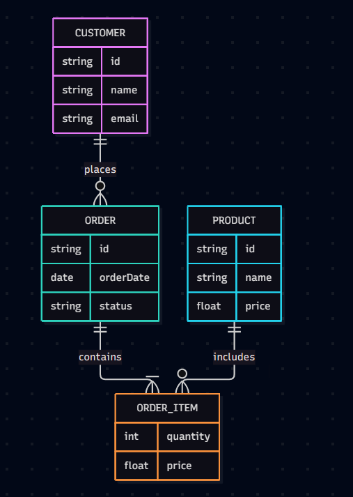

# ER Audit — Legacy Database

## 1. Entities, Attributes, and Intended Primary Keys

The legacy database contains three tables: `machine`, `part`, and `maint_job`. The tables contain information about machines, spare parts, and maintenance jobs. However, the schema has structural problems, including missing primary keys and relationships represented using text.

### 1.1 Machine

**Legacy table:** `machine`

| Attribute      | Description             | Intended constraint           |
| -------------- | ----------------------- | ----------------------------- |
| `machine_name` | Name of the machine     | Not the preferred primary key |
| `serial_no`    | Machine serial number   | UNIQUE                        |
| `site`         | Location of the machine | —                             |
| `installed`    | Installation date       | DATE                          |

**Intended primary key:** `machine_id`

A surrogate primary key, `machine_id`, should be added to uniquely identify each machine. The serial number should also be unique because it identifies the machine in the real world.

### 1.2 Part

**Legacy table:** `part`

| Attribute     | Description                              | Intended constraint |
| ------------- | ---------------------------------------- | ------------------- |
| `part_no`     | Part number                              | UNIQUE              |
| `description` | Description of the part                  | —                   |
| `unit_price`  | Price per unit, currently stored as TEXT | Numeric type        |

**Intended primary key:** `part_id`

A surrogate primary key, `part_id`, should be introduced. The existing `part_no` should remain unique to prevent duplicate part numbers. The `unit_price` column should use an appropriate numeric representation rather than TEXT.

### 1.3 MaintenanceJob

**Legacy table:** `maint_job`

| Attribute      | Description                               | Intended constraint                      |
| -------------- | ----------------------------------------- | ---------------------------------------- |
| `job_id`       | Maintenance job identifier                | PRIMARY KEY                              |
| `machine_name` | Name of the machine being maintained      | Replace with `machine_id` foreign key    |
| `technician`   | Name of the technician performing the job | Replace with `technician_id` foreign key |
| `done_on`      | Date the job was completed                | DATE                                     |
| `parts_used`   | Comma-separated list of part numbers      | Replace with a junction table            |

**Intended primary key:** `job_id`

The maintenance job should reference a machine through `machine_id` and a technician through `technician_id`. The `parts_used` attribute should be removed because a list of part numbers in one column does not properly represent a many-to-many relationship.

### 1.4 Technician

**Legacy representation:** The technician is stored as text in `maint_job.technician`. There is no separate technician entity in the visible legacy schema.

**Intended entity:** A separate `technician` table should be introduced.

| Attribute       | Description           | Intended constraint |
| --------------- | --------------------- | ------------------- |
| `technician_id` | Technician identifier | PRIMARY KEY         |
| `name`          | Technician's name     | —                   |

**Intended primary key:** `technician_id`

A separate table allows each technician to be identified consistently and associated with multiple maintenance jobs.

### 1.5 Job_Part (Junction Table)

**Legacy representation:** The relationship between maintenance jobs and parts is hidden inside `maint_job.parts_used`.

**Intended entity/table:** `job_part`

| Attribute | Description                | Intended constraint      |
| --------- | -------------------------- | ------------------------ |
| `job_id`  | Referenced maintenance job | PRIMARY KEY, FOREIGN KEY |
| `part_id` | Referenced part            | PRIMARY KEY, FOREIGN KEY |

**Intended primary key:** Composite key `(job_id, part_id)`

This junction table resolves the many-to-many relationship between maintenance jobs and parts. The composite primary key ensures that a particular part can appear only once per maintenance job.

---

## 2. Summary of Intended Primary Keys

| Entity         | Intended primary key |
| -------------- | -------------------- |
| Machine        | `machine_id`         |
| Part           | `part_id`            |
| MaintenanceJob | `job_id`             |
| Technician     | `technician_id`      |
| Job_Part       | `(job_id, part_id)`  |

---

## ER Diagram for Legacy.db

## Cardinilaties Evidence from Query

