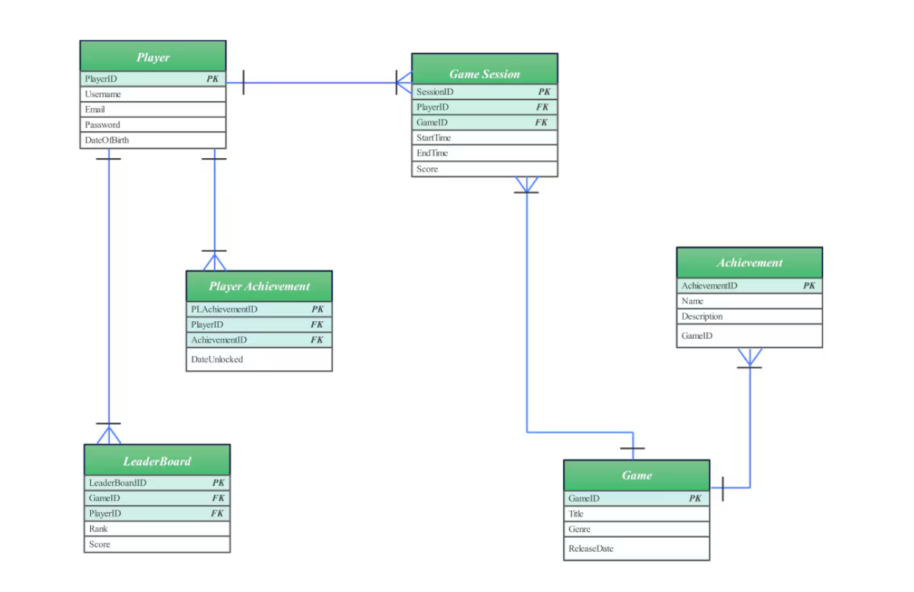
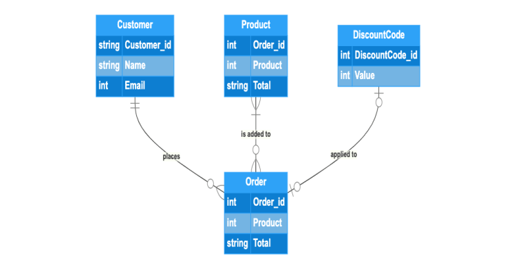
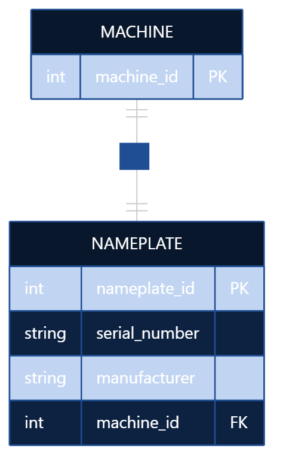
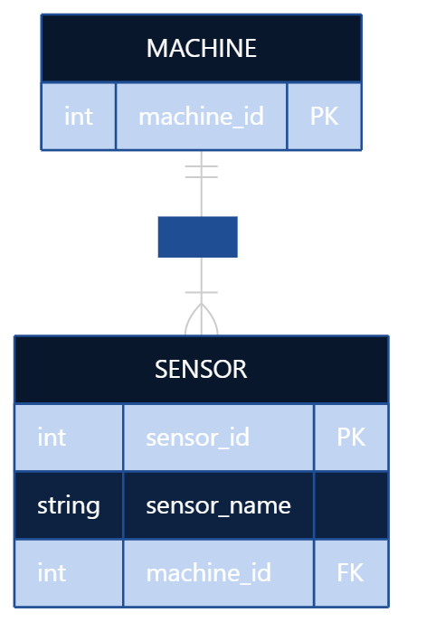
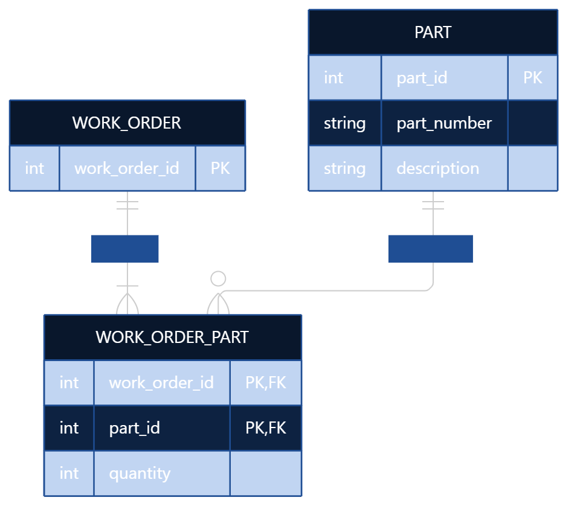
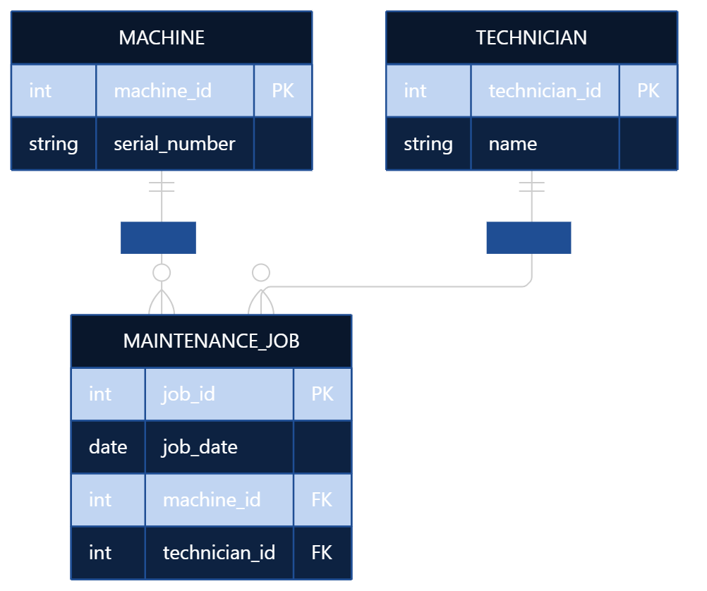
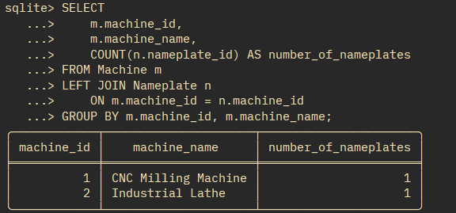
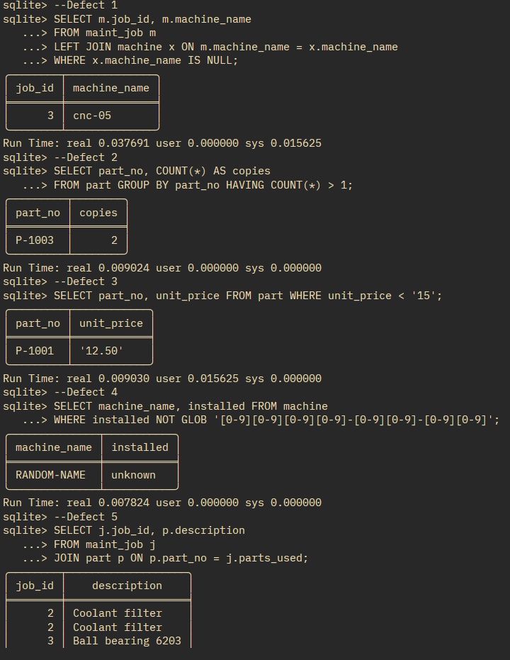

# Task A

## Self-Study Logs - Module 2 

- Terms like ER diagrams, entities, attributes, relationships, cardinalities, and primary, foreign, natural and surrogate keys explained by ChatGPT (GPT-5.6 Luna). Prompt: "Define ER diagrams, entities, attributes, relationships, cardinalities, and primary, foreign, natural and surrogate keys in simple terms." Response: The LLM gave simple definations of each term with easy to understand examples.
- Normalization and 1NF explained using [this](https://www.youtube.com/watch?v=mUtAPbb1ECM) youtube video.
- ER diagram basics explained from [this](https://www.youtube.com/watch?v=xsg9BDiwiJE) youtube video and also [this one](https://www.youtube.com/watch?v=hktyW5Lp0Vo).
- Basic syntax and use cases of Pydantic and SQLAlchemy explained by ChatGPT (GPT-5.6 Luna). Prompt: "Teach me basics uses, and the difference between  Pydantic and SQLAlchemy in simple terms." Response: Basic syntax and code example and the main difference explained as:
 
  Pydantic = Inspector: Checks whether the data meets your requirements.
  SQLAlchemy = Architect and translator: Defines the database structure and translates Python operations into SQL.

- ER diagrams that were helpful in learning the concept:

  
  

# Task B 

## One-to-one (1:1) — Machine and Nameplate:

---

## One-to-many (1:N) — Machine and Sensors

---

## Many-to-many (M:N) — Work Orders and Parts

---

## Entity vs. Attribute vs. Relationship — Maintenance Jobs

   

  

   - MACHINE is an entity.
   - TECHNICIAN is an entity because technicians have their own identities and information.
   - MAINTENANCE_JOB is also an entity because each job has its own ID and date.
  - job_date is an attribute of the maintenance job.
  - The relationships are represented by foreign keys in MAINTENANCE_JOB.

---

## COUNT Query for 1st Diagram: 

  
  

---

# Task C 

- Not Applicable as class was not attended physically.

---

# Task 2 

## Defect Queries and Results

## Production relevance for respective defects:

- Defect 1: A machine that doesn't exist! Unreliabled data. 
- Defect 2: Duplicate part numbers! Incorrect inventory counts, duplicate orders etc. 
- Defect 3: Price stored as text! Can not do calculations. 
- Defect 4: Invalid Date! scheduling problems etc. 
- Defect 5: Seperated by comma! Can produce incorrect data. 

# Task 3 

## contract.py output: 

CREATE TABLE machine (  
	machine_id INTEGER NOT NULL,  
	serial_no VARCHAR NOT NULL,  
	site VARCHAR NOT NULL,  
	installed DATE NOT NULL,  
	PRIMARY KEY (machine_id),   
	CONSTRAINT uq_machine_serial UNIQUE (serial_no)   
) ;     

CREATE TABLE part (  
	part_no VARCHAR NOT NULL,  
	description VARCHAR NOT NULL,   
	unit_price NUMERIC(9, 2) NOT NULL,   
	PRIMARY KEY (part_no)  
) ;    

CREATE TABLE maint_job (  
	job_id INTEGER NOT NULL,   
	machine_id INTEGER NOT NULL,   
	technician VARCHAR NOT NULL,   
	done_on DATE NOT NULL,   
	PRIMARY KEY (job_id),  
	FOREIGN KEY(machine_id) REFERENCES machine (machine_id)  
) ;     

CREATE TABLE job_part (  
	job_id INTEGER NOT NULL,  
	part_no VARCHAR NOT NULL,   
	PRIMARY KEY (job_id, part_no),   
	FOREIGN KEY(job_id) REFERENCES maint_job (job_id),  
	FOREIGN KEY(part_no) REFERENCES part (part_no)   

## Constraints enforced in the model (Pydantic)
	
I use Pydantic to validate data before it reaches the database. For example, it can check that required strings are not empty, that installation and maintenance dates are valid, and that part prices are non-negative. This helps catch invalid input early and provides clear error messages.
	
## Constraints enforced in the database (SQLAlchemy DDL)
	
I use database constraints to protect the integrity of stored data:
	
- Primary keys: Identify each machine, part, and maintenance job uniquely.
- NOT NULL: Prevents required columns from being left empty.
- UNIQUE: Prevents duplicate machine serial numbers.
- Foreign keys: Ensure that maintenance jobs reference existing machines and that job-part records reference existing jobs and parts.
- Composite primary key: The combination of job_id and part_no prevents the same part from being listed more than once for a maintenance job.
