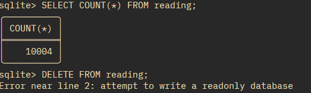

# Task A 

# Observation: 

When unconstrained table was tested SQLite accepted the data without any problem, when constraint were introduced and the 'safe' table was used, the following findings were found for the respective INSERTs: 
___

### INSERT INTO t_safe VALUES (1, 'temp_c', 9000);

### Constraint: 

CHECK 

### Error Message: 

Error near line 18: CHECK constraint failed: value BETWEEN -273.15 AND 5000
___

### INSERT INTO t_safe VALUES (2, 'bogus', -500);

### Constraint:

CHECK

### Error Message:

  Error near line 20: CHECK constraint failed: metric IN ('temp_c', 'vib_rms', 'spindle_load')
___

### INSERT INTO t_safe VALUES (NULL, 'temp_c', 30);

No constraint stopped the data record from being inserted because SQLite treats NULL as an unknown not '0' so our Check(value > 10) doesn't work. This is also the example of a record that was still wrong and bypassed the cosntraints.
___

### INSERT INTO t_safe VALUES (1, 'vib_rms', 20); 

### Constraint: 

UNIQUE 

### Error Message: 

Error near line 22: UNIQUE constraint failed: t_safe.sensor_id
___


# Task B 

Module completed via self study, hence not applicable. Although when compared with another pod's repo (with permission ofcourse) they also had the NULL data as the most surprising part and the rest of their findings were almost identical to mine. 

# Task 1 

## Rejected statemetns: 

```
INSERT INTO reading(sensor_id, ts, value, interval_s)
   ...> VALUES (1,'2026-03-01 08:00:01',9000,1)
```
#### Error Message: 
Error near line 29: CHECK constraint failed: value >= -273.15 AND value <= 5000

___

```
INSERT INTO reading(sensor_id, ts, value, interval_s)
   ...> VALUES (1,'2026-03-01 08:00:02','hot',1);
```
#### Error Message: 
Error near line 31: cannot store TEXT value in REAL column reading.value

___

```
INSERT INTO reading(sensor_id, ts, value, interval_s)
   ...> VALUES (99,'2026-03-01 08:00:03',40,1);
```
#### Error Message: 
Error near line 33: FOREIGN KEY constraint failed

___

```
INSERT INTO sensor VALUES (3,'cnc-01','temp_c','degC');
```
#### Error Message: 
Error near line 35: UNIQUE constraint failed: sensor.machine_id, sensor.metric

___

## Virtual Column `energy_j` proof: 


# Task 2

### `UPSERT` SQL:

``` 
INSERT INTO reading(sensor_id, ts, value, interval_s)
VALUES (1,'2026-03-01 08:00:00',41.7,1)

ON CONFLICT(sensor_id, ts)
DO UPDATE SET value = excluded.value;
``` 

---
The [ingest.py](ingest.py) file can be located in the same folder. Made by ChatGPT free model, verified by testing on data in [readings.csv](readings.csv)

--- 

## Row-count proof: 


The second block of code checks for duplicate rows and returns nothing.

---

# Task 3 

## Alarm trigger: 

```
CREATE TRIGGER trg_vib_alarm

AFTER INSERT ON reading

FOR EACH ROW

WHEN NEW.value > 2.0
AND (
    SELECT metric
    FROM sensor
    WHERE sensor_id = NEW.sensor_id
) = 'vib_rms'

BEGIN

    INSERT INTO alarm(sensor_id, ts, value, reason)

    VALUES (
        NEW.sensor_id,
        NEW.ts,
        NEW.value,
        'vibration over 2.0 mm/s'
    );

END;

```

## Output: 


## Audit trigger: 

``` 

CREATE TRIGGER trg_reading_audit

AFTER UPDATE OF value ON reading

FOR EACH ROW

BEGIN

    INSERT INTO audit(
        reading_id,
        old_value,
        new_value
    )

    VALUES (
        NEW.reading_id,
        OLD.value,
        NEW.value
    );

END;

``` 

## Output: 


---

## Performance analysis: 

10,000 readings were tested using the `benchmark.py` code which produced the following result:

```
=== WITHOUT TRIGGER ===
Run 1: 0.0378 seconds
Run 2: 0.0302 seconds
Run 3: 0.0541 seconds

=== WITH TRIGGER ===
Run 1: 0.1048 seconds
Run 2: 0.1170 seconds
Run 3: 0.1036 seconds

=== FINAL RESULTS ===
Without trigger: 0.0378 seconds
With trigger:    0.1048 seconds
Difference:      0.0670 seconds
Overhead:        177.07%
Generated alarms: 5000
```

The data with the triggers was 177% slower! 

# Task 4 

## `mode=ro` Commands: 

``` 
icacls Module04/edge.db /inheritance:r
icacls Module04/edge.db /grant:r "$($env:USERNAME):(R)"
``` 



The above terminal screenshot demonstrates that after the file was changed to Read-Only, modifications such as DELETE resulted in an error while the data could still be read normally from the tables. 

---

## Comparision with PostgreSQL:

PostgreSQL provides built-in access control through users, roles, GRANT and REVOKE statements. This allows administrators to assign specific permissions to different users, such as allowing someone to read a table without being able to modify it. SQLite does not have this type of user and role management because it is a file-based database. Instead, access is controlled mainly through operating system file permissions and read-only connections.
