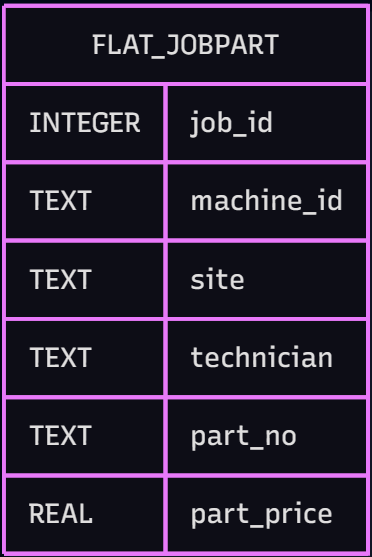
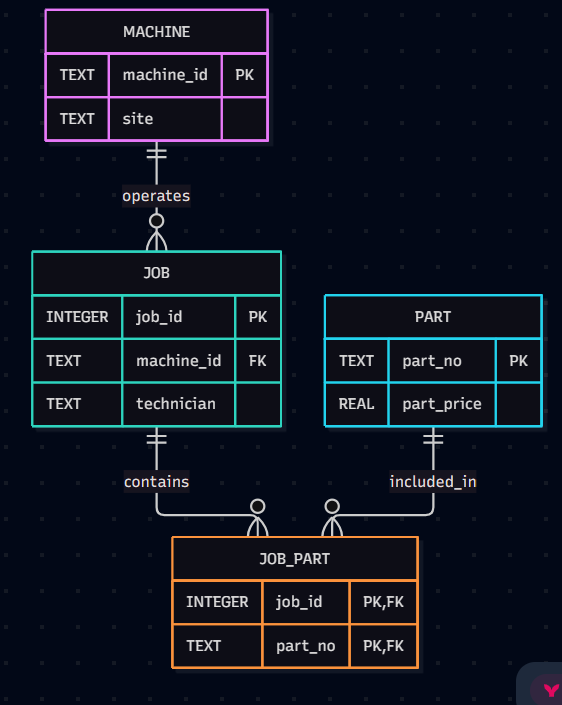

# Round 1 

## Functional Dependencies:


#### job_id → technician 
| Guaranteed (Assuming one technicial per job)
#### machine_id → site 
| Guaranteed (Assuming machines are not to be moved)
#### part_no → part_price 
| Guaranteed (Assuming prices are updated and always known)

### LLM Check: 

ChatGPT (Free Model | 12.11.2026) agreed with my FDs and shared an identical list. 

---

### Current table: 



### Redesigned: 




# Round 2

| Anomaly | SQL Statement | What happens in the flat table? |
|---|---|---|
| UPDATE | UPDATE flat5 <br>SET site = 'Bielefeld'<br>WHERE machine_id = 'cnc-01'; | Updating a machine's location requires changing multiple rows. Forgetting one creates inconsistent data. |
| INSERT | INSERT INTO flat5 (part_no, part_price)<br>VALUES ('P-0004', 10.00); | Adding a new part requires creating a row with unrelated or NULL information. |
| DELETE | DELETE FROM flat5<br>WHERE job_id = 1 AND part_no = 'P-0002'; | Deleting the last job using a part also deletes the only record of that part. |

___

# Round 3 

## Normalization:

200000 rows setup can be found in `setup.sql` resulting in the flat_jobpart table. SQL for normalization and data transfer from flat_jobpart into individual tables can be found in `normalize.db`. 

## Row-count Individual: 

```
sqlite> SELECT COUNT(*) FROM machine;
╭──────────╮
│ COUNT(*) │
╞══════════╡
│       50 │
╰──────────╯
sqlite> SELECT COUNT(*) FROM part;
╭──────────╮
│ COUNT(*) │
╞══════════╡
│       10 │
╰──────────╯
sqlite> SELECT COUNT(*) FROM job;
╭──────────╮
│ COUNT(*) │
╞══════════╡
│    20000 │
╰──────────╯
sqlite> SELECT COUNT(*) FROM job_part;
╭──────────╮
│ COUNT(*) │
╞══════════╡
│   200000 │
╰──────────╯
```

### Row integrity check: 

``` 
sqlite> SELECT
   ...>     (SELECT COUNT(*) FROM flat_jobpart) AS flat_rows,
   ...>     (SELECT COUNT(*) FROM job_part) AS normalized_rows;
╭───────────┬─────────────────╮
│ flat_rows │ normalized_rows │
╞═══════════╪═════════════════╡
│    200000 │          200000 │
╰───────────┴─────────────────╯
```
## Normalization explained: 

### First Normal Form (1NF)

The original table already satisfies 1NF because each cell contains a single atomic value. There are no lists or multiple values stored in individual cells.

### Second Normal Form (2NF)

The candidate key is (job_id, part_no).

The original table contains partial dependencies:
- job_id → machine_id, technician, done_on
- part_no → part_price

These attributes depend on only part of the composite key. I separated them into JOB and PART tables.

### Third Normal Form (3NF)

I separated machine information into its own MACHINE table.

The resulting dependencies are:
- machine_id → site
- job_id → machine_id, technician, done_on
- part_no → part_price

This removes unnecessary duplication and ensures that non-key attributes depend on the key, the whole key, and nothing but the key! 

# Round 4

### SQL for De-normalization: 

``` 
DROP TABLE IF EXISTS report_jobpart;

CREATE TABLE report_jobpart AS
SELECT
    j.job_id,
    m.machine_id,
    m.site,
    j.technician,
    jp.part_no,
    p.part_price,
    j.done_on
FROM job j
JOIN machine m
    ON m.machine_id = j.machine_id
JOIN job_part jp
    ON jp.job_id = j.job_id
JOIN part p
    ON p.part_no = jp.part_no;

CREATE INDEX ix_report_machine
ON report_jobpart(machine_id);
``` 

#### Verification: 

``` 
sqlite> SELECT COUNT(*) FROM report_jobpart;
╭──────────╮
│ COUNT(*) │
╞══════════╡
│   200000 │
╰──────────╯
```

### Testing the Normalized Version: 

#### SQL Query: 

``` 
SELECT
    m.machine_id,
    m.site,
    j.technician,
    SUM(p.part_price) AS cost
FROM job j
JOIN machine m
    ON m.machine_id = j.machine_id
JOIN job_part jp
    ON jp.job_id = j.job_id
JOIN part p
    ON p.part_no = jp.part_no
WHERE j.done_on >= date('2026-03-01')
GROUP BY m.machine_id, j.technician;

``` 
#### Query Plan: 
``` 
QUERY PLAN
|--SCAN jp
|--SEARCH j USING INTEGER PRIMARY KEY (rowid=?)
|--SEARCH m USING INDEX sqlite_autoindex_machine_1 (machine_id=?)
|--SEARCH p USING INDEX sqlite_autoindex_part_1 (part_no=?)
`--USE TEMP B-TREE FOR GROUP BY
```


#### Procedure and Result: 
- Ran first with timming off. 
- Calculating the time 3 times and taking the median value: Run Time: `0.805135`

### Testing the Denormalized Version: 

#### SQL Query:

```
SELECT
    machine_id,
    site,
    technician,
    SUM(part_price) AS cost
FROM report_jobpart
WHERE done_on >= date('2026-03-01')
GROUP BY machine_id, technician;
``` 

#### Query Plan: 
``` 
QUERY PLAN
|--SCAN report_jobpart USING INDEX ix_report_machine
`--USE TEMP B-TREE FOR GROUP BY
```

#### Query Plan (Index Dropped):
```
QUERY PLAN
|--SCAN report_jobpart
`--USE TEMP B-TREE FOR GROUP BY
```

#### Procedure and Result: 

- Ran first with timming off. 
- Calculating the time 3 times and taking the median value: Run Time: `0.701149`
- Calculating the time 3 times without index `ix_report_machine`: `0.062500`

#### Note: 

Both queries ran one after another in alternation to take warm cache into accound. Denormalized query was slightly faster and specifically, dropping the index made the query run even faster! My theory for the difference being insignifant is probably the data set is not big enough. ChatGPT says its becasue Sqlite3 handles JOIN statements quit well apparently.


# Round 5

| Design | Dashboard query (ms) | Rows changed by site update | Storage (KB) | Redundancy |
|---|---:|---:|---:|---|
| Normalized (3NF) | 0.063488 | 1 | 3976.0 | None |
| Denormalized | 0.076151 <br> 0.008642*  | 4000 | 10832.0 | Site, technician, price repeated |

*Index dropped.

### Analysis: 

- **Normalized:** Updates only 1 row when a machine's site changes.
- **Denormalized:** Updates approximately 4,000 rows because machine information is repeated.
- **Storage:** Denormalization requires more space due to duplicated data.
- **Indexes:** An index does not always improve performance; a full table scan can sometimes be faster.
- **Conclusion:** Normalization makes updates safer and reduces duplication, while denormalization can simplify reporting queries at the cost of storage and update performance.


# Round 6

I recommend keeping the operational database normalized to 3NF and using a separate denormalized table (`report_jobpart`) for the machine-health dashboard.

The normalized design is better for daily operations because it reduces duplicated data and prevents update, insert and delete anomalies.

The denormalized design can improve dashboard performance because it requires fewer JOIN operations.

However, it requires more storage and creates a risk of outdated or inconsistent information.

To prevent this, I would initially use a scheduled rebuild of the reporting table, so that it regularly receives updated information from the normalized tables.

According to our benchmark, the normalized dashboard query took **[0.860 seconds]**, while the denormalized query took **[0.934 seconds]**.

The denormalized design used **[10,832.0] KB** of storage compared with **[3,976.0] KB** for the normalized design.

Therefore, I would use both designs: 3NF for reliable daily operations and denormalization for faster analytical queries.


# Round 7


## 1. Why does CROSS JOIN generate 200,000 rows?

A CROSS JOIN combines every row from one table with every row from another table.

In our experiment, 20,000 jobs were combined with 10 parts per job, producing:

20,000 × 10 = 200,000 rows.

## 2. Why is DISTINCT necessary during normalization?

The original flat table contains repeated machine, job and part information.

SELECT DISTINCT removes duplicate combinations when transferring this information into separate normalized tables.

## 3. Why can denormalization improve read performance?

Denormalization combines information from multiple tables into one reporting table. This can reduce the number of joins required by frequently executed queries.

## 4. Why does denormalization increase update costs?

Duplicated information must be updated in every location where it appears. Missing even one copy can create inconsistent data.

## 5. Why can an index make a query slower?

An index introduces additional structures that SQLite may need to scan or access. If the query needs a large proportion of the table, a full table scan can sometimes be cheaper.

## 6. Can database triggers maintain a denormalized reporting table?

Yes. Triggers can automatically execute after INSERT, UPDATE or DELETE operations. They can help synchronize duplicated information, but they also add complexity and write overhead.

## 7. Could DuckDB make denormalization less necessary?

DuckDB is designed for analytical workloads and uses column-oriented storage and vectorized execution. It may execute analytical queries efficiently even when the data is normalized. This would be an interesting comparison with SQLite.

## Final takeaway

Normalization and denormalization solve different problems. Normalization improves data consistency and reduces duplication, while denormalization can simplify and potentially accelerate read-heavy workloads. The correct design depends on actual performance measurements and application requirements.
